[](https://pypi.org/project/deltakin/)
[](https://pypi.org/project/deltakin/)
[](https://pypi.org/project/deltakin/)
[](LICENSE)
[](pyproject.toml)

# deltakin

Forward and inverse kinematics for 3-DOF Delta parallel robots, in pure Python (no dependencies).

<p align="center">
  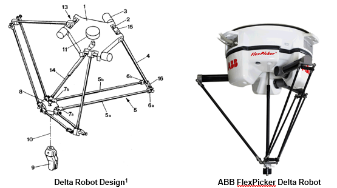
</p>
<p align="center"><em>Left: Clavel's original Delta robot design (US Patent 4,976,582). Right: ABB FlexPicker.</em></p>

The model and equations follow R. L. Williams II, *The Delta Parallel Robot: Kinematics Solutions* (Ohio University), revolute-input (RUU legs) version. See [Reference](#reference) and [Figures and credits](#figures-and-credits).

## Contents

- [Install](#install)
- [Usage](#usage)
- [Robot model](#robot-model)
- [Conventions](#conventions)
- [How it works](#how-it-works)
- [Reference examples](#reference-examples)
- [Trajectory examples](#trajectory-examples)
- [Tests](#tests)
- [Reference](#reference)
- [Figures and credits](#figures-and-credits)
- [Open source and contributions](#open-source-and-contributions)
- [Author](#author)
- [License](#license)

## Install

```bash
pip install deltakin
```

## Usage

```python
from deltakin import DeltaRobot, UnreachableError

robot = DeltaRobot(Sb=567, Sp=76, L=524, l=1244)    # lengths in mm

angles = robot.inverse(0, 0, -900)                   # degrees -> about (-20.55, -20.55, -20.55)
x, y, z = robot.forward(*angles)                     # -> (0, 0, -900)

robot.is_reachable(0, 0, 0)                          # False

try:
    robot.inverse(0, 0, 0)
except UnreachableError as err:
    print(err)                                       # clear error, no fake angles

primary, alternate = robot.inverse_all(100, -50, -1000)   # both solutions
robot.inverse_many([(0, 0, -900), (50, 20, -1000)])        # batches
DeltaRobot(567, 76, 524, 1244, angle_unit="rad")           # radians instead of degrees
```

### Constructor parameters

| Argument | Meaning | Paper symbol | Example (mm) |
| --- | --- | --- | --- |
| `Sb` | base equilateral triangle side | s<sub>B</sub> | 567 |
| `Sp` | platform equilateral triangle side | s<sub>P</sub> | 76 |
| `L` | upper leg length (actuated link) | L | 524 |
| `l` | lower leg length (parallelogram) | l | 1244 |

The example values are those of the ABB FlexPicker IRB 360-1/1600 used in the paper. The parallelogram width *h* (131 mm in the paper) does not enter the kinematics, because each parallelogram is modelled by its virtual centre length *l*.

## Robot model

The 3-DOF Delta robot has three identical **RUU** legs between a fixed base and a moving platform. The top revolute joint of each leg is actuated. The two universal (**U**) joints and the parallelogram of each lower leg keep the platform at a constant orientation, so the platform only translates in X, Y and Z.

Points **B**<sub>i</sub> are the hips, **A**<sub>i</sub> the knees and **P**<sub>i</sub> the ankles. The platform triangle is inverted with respect to the base triangle.

<p align="center">
  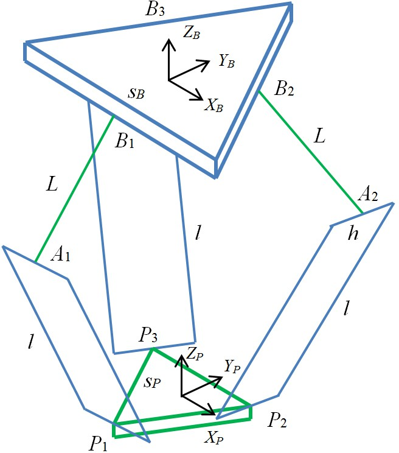
</p>

<p align="center">
  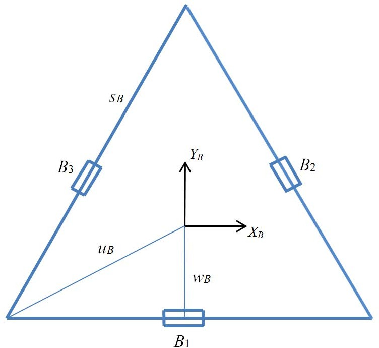
  &nbsp;&nbsp;
  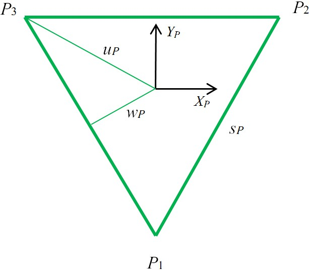
</p>

Base frame `{B}` has its origin at the centre of the base triangle, and platform frame `{P}` at the centre of the platform triangle. Both frames always have the same orientation.

Derived dimensions (paper values for the FlexPicker, in mm):

| Quantity | Formula | Value |
| --- | --- | --- |
| w<sub>B</sub> | (√3 / 6) s<sub>B</sub> | 164 |
| u<sub>B</sub> | (√3 / 3) s<sub>B</sub> | 327 |
| w<sub>P</sub> | (√3 / 6) s<sub>P</sub> | 22 |
| u<sub>P</sub> | (√3 / 3) s<sub>P</sub> | 44 |

w is the distance from the centre to the nearest side of the triangle, and u is the distance from the centre to a vertex.

Hip points in `{B}` and ankle points in `{P}`:

```text
B1 = ( 0,          -wB,    0)        P1 = ( 0,      -uP, 0)
B2 = ( (√3/2)·wB,   wB/2,  0)        P2 = ( sP/2,    wP, 0)
B3 = (-(√3/2)·wB,   wB/2,  0)        P3 = (-sP/2,    wP, 0)
```

## Conventions

- Origin at the centre of the base, z up (a hanging platform has negative z).
- Leg 1 on the -y side; legs 2 and 3 on the +x and -x sides.
- Lengths use any single unit; angles default to degrees.
- Joint angle θ<sub>i</sub> is zero when the upper leg is horizontal. Positive θ swings the knee **below** the horizontal plane, negative θ raises it. The knee height is `-L·sin(θ)` relative to the hip, so the nominal pose `(0, 0, -900)` gives θ ≈ -20.55° on all three legs.
- `inverse(..., branch="primary")` returns the usual elbow-out ("knees kinked out") solution; `"alternate"` returns the other one.

## How it works

### Loop closure

For each leg *i* the vector loop closes as

```text
B_i + L_i + l_i = P + P_i        (i = 1, 2, 3)      with   |l_i| = l
```

where `L_i` is the upper leg vector, which depends only on θ<sub>i</sub>:

```text
L1 = (0,                 -L·cos θ1,    -L·sin θ1)
L2 = ( (√3/2)·L·cos θ2,   (1/2)·L·cos θ2, -L·sin θ2)
L3 = (-(√3/2)·L·cos θ3,   (1/2)·L·cos θ3, -L·sin θ3)
```

### Inverse kinematics (closed form, per leg)

Each leg is solved independently. Squaring the length constraint gives one equation per leg:

```text
E_i·cos θ_i + F_i·sin θ_i + G_i = 0
```

with `E_i`, `F_i`, `G_i` functions of the target `(x, y, z)` and the robot dimensions (see the paper for the full expressions). The equation is solved with the tangent half-angle substitution `t = tan(θ/2)`, which gives a quadratic in `t`.

The two roots per leg are "knee out" and "knee in", so there are 2³ = 8 combinations in total. The library returns the usual elbow-out solution as `primary` and the other root as `alternate`. If a discriminant is negative, the point is outside the workspace and `UnreachableError` is raised.

### Forward kinematics (three-spheres intersection)

Because the platform never rotates, the knee points `A_i = B_i + L_i` are known from the three joint angles. Moving each knee point by `-P_i` turns the problem into finding the point at distance `l` from the three shifted points, which is the intersection of three spheres of equal radius `l`.

<p align="center">
  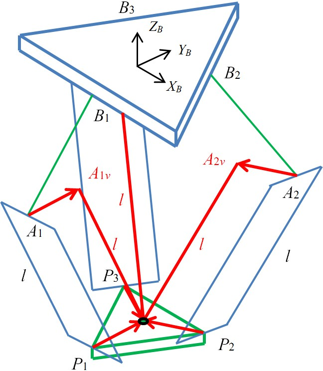
</p>

Two intersection points exist in general (one above and one below the base). The one below the base is the admissible solution and is the one returned.

## Reference examples

These are the snapshot examples from the paper (FlexPicker dimensions, converted from metres to mm):

| Joint angles θ (deg) | Platform position P (mm) |
| --- | --- |
| (0, 0, 0) | (0, 0, -1065) |
| (-20.55, -20.55, -20.55) | (0, 0, -900) |
| (10, 20, 30) | (108, -180, -1244) |
| (47.5, -11.6, 21.4) | (300, 500, -1100) |

The paper checks each one in both directions (inverse then forward, and forward then inverse). The signs and the leg ordering above were also checked independently against the loop-closure equations.

## Trajectory examples

### Inverse kinematics trajectory

The platform follows a circle of radius 500 mm centred on `(0, 0, -1000)`, while z goes through two full sine cycles of amplitude 200 mm. The angles are computed with `inverse_many`:

```python
import math
from deltakin import DeltaRobot

robot = DeltaRobot(Sb=567, Sp=76, L=524, l=1244)

n = 72
path = []
for k in range(n + 1):
    t = 2 * math.pi * k / n
    path.append((500 * math.cos(t), 500 * math.sin(t), -1000 + 200 * math.sin(2 * t)))

angles = robot.inverse_many(path)
```

<p align="center">
  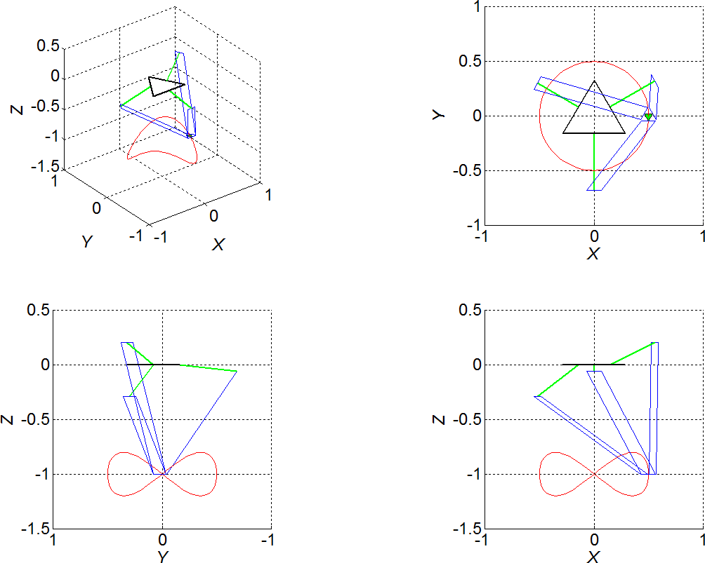
</p>

<p align="center">
  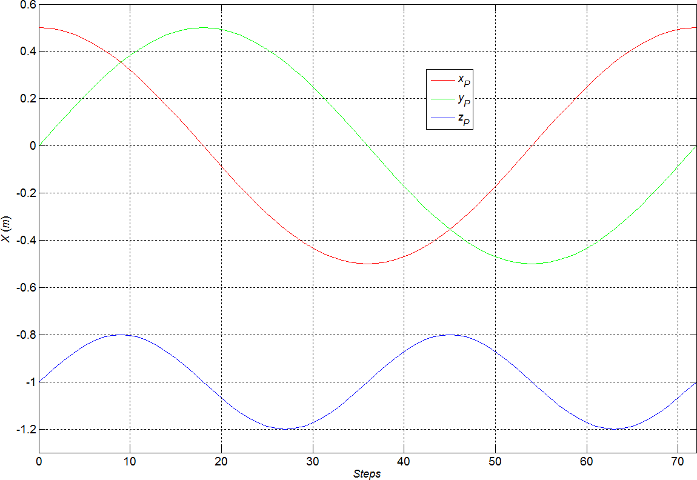
  &nbsp;
  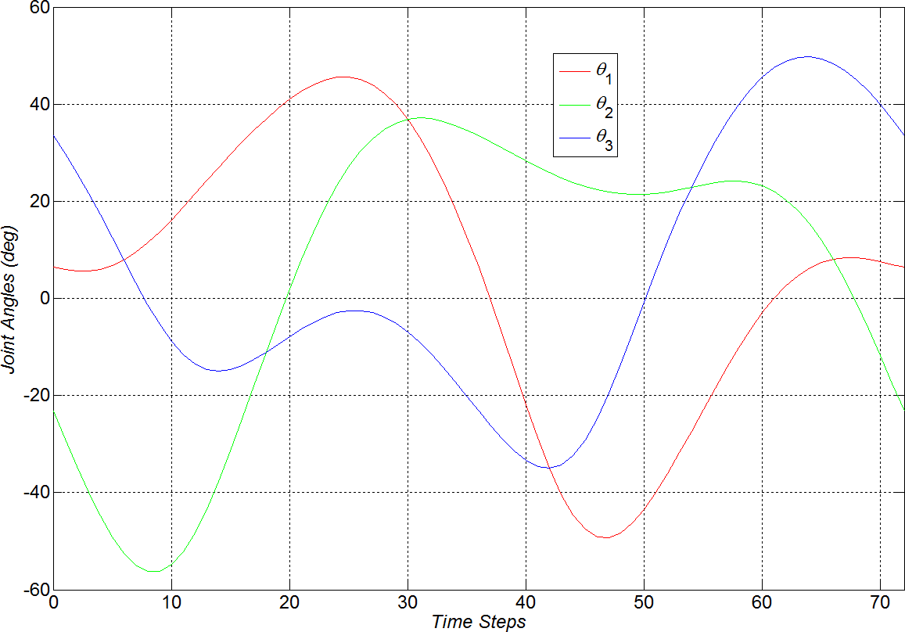
</p>

*Left: commanded Cartesian positions. Right: joint angles returned by the inverse solution.*

### Forward kinematics trajectory

A demonstration run in the other direction. The three joint angles follow θ<sub>1</sub> = θ<sub>max</sub>·sin(t), θ<sub>2</sub> = θ<sub>max</sub>·sin(2t) and θ<sub>3</sub> = θ<sub>max</sub>·sin(3t) with θ<sub>max</sub> = 45° and t from 0 to 2π in 100 steps. This is not a useful robot motion; it exercises the forward solution over a wide range of poses.

<p align="center">
  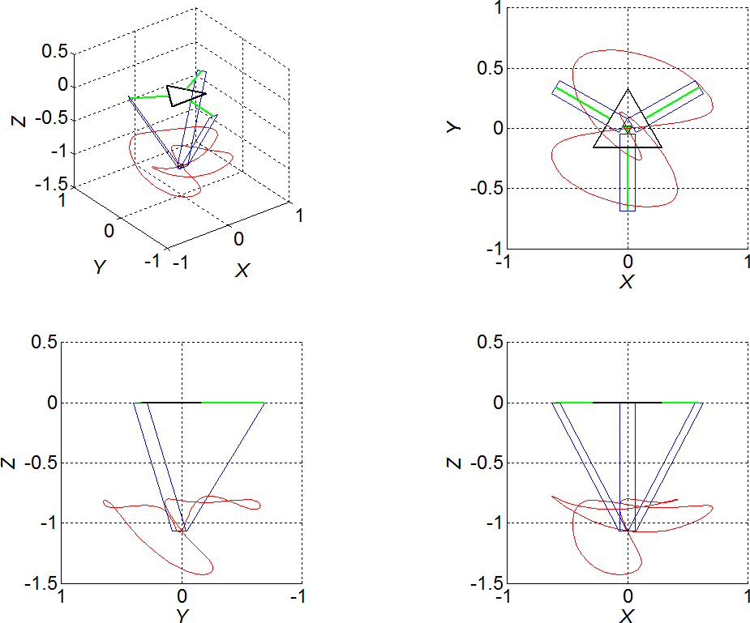
</p>

<p align="center">
  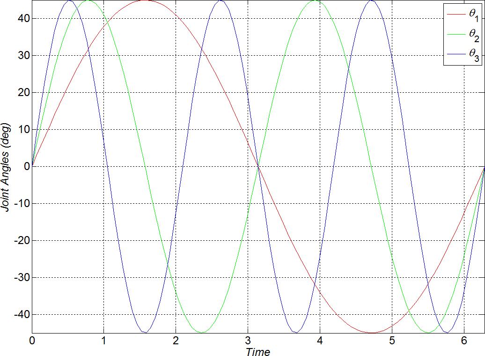
  &nbsp;
  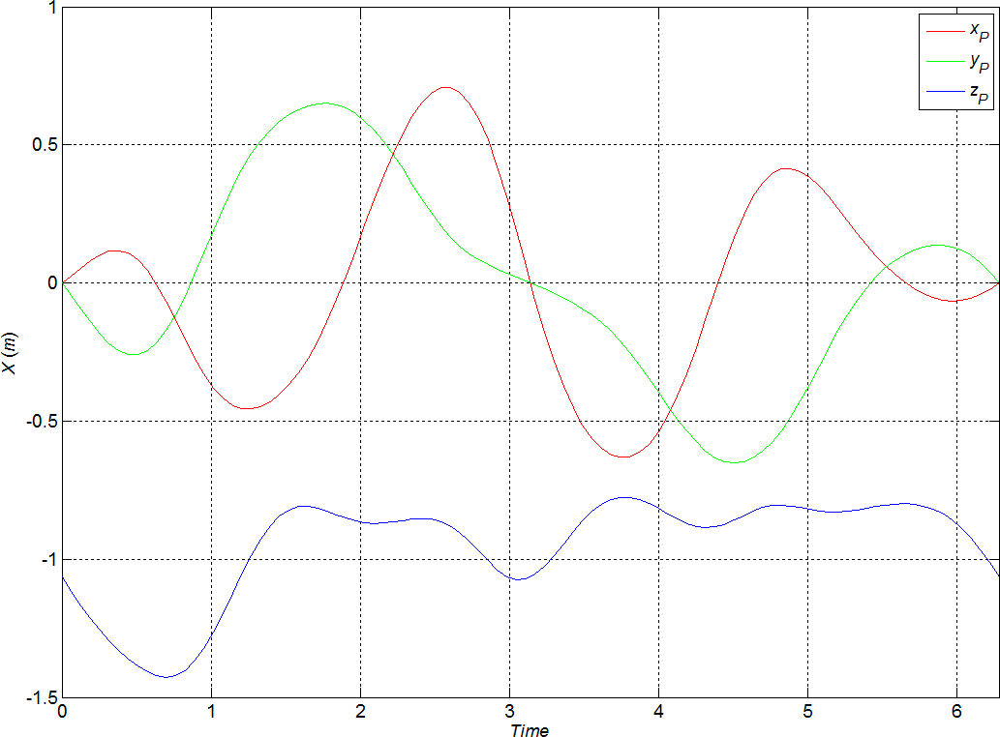
</p>

*Left: commanded joint angles. Right: platform positions returned by the forward solution.*

## Tests

```bash
PYTHONPATH=src python -m unittest discover -s tests -v
```

The test suite includes round trips (inverse then forward, and forward then inverse), the example from the Williams paper, and a mirror-symmetry check.

## Reference

R. L. Williams II, "The Delta Parallel Robot: Kinematics Solutions", Internet Publication, Mechanical Engineering, Ohio University, 2016.
[www.ohio.edu/people/williar4/html/pdf/DeltaKin.pdf](http://www.ohio.edu/people/williar4/html/pdf/DeltaKin.pdf)

The Delta robot itself is due to R. Clavel, *Conception d'un robot parallèle rapide à 4 degrés de liberté*, Ph.D. thesis, EPFL, Lausanne, 1991 (US Patent 4,976,582, 1990).

## Figures and credits

The diagrams and plots in [`assets/`](assets) are taken from the Williams paper above and remain the property of their author. They are included here only to document the model and the conventions used by the code. The MIT license of this repository covers the source code, not these figures.

| File | Content |
| --- | --- |
| `delta-robot-overview.png` | Clavel's original design (patent drawing) and the ABB FlexPicker photo |
| `kinematic-diagram.jpg` | Kinematic diagram of the Delta robot |
| `base-frame.jpg` | Fixed base triangle and frame {B} |
| `platform-frame.jpg` | Moving platform triangle and frame {P} |
| `vector-loop-fpk.jpg` | Forward kinematics vector loop (shifted knee points) |
| `ipk-trajectory-*.png` | Inverse trajectory example: robot pose, Cartesian path, joint angles |
| `fpk-trajectory-*.png` | Forward trajectory example: robot pose, joint angles, Cartesian path |

The ABB FlexPicker photo belongs to ABB and is shown only for illustration.

## Open source and contributions

**deltakin** is an open-source project released under the MIT License.

Contributions from the community are welcome! You are free to use, modify, extend, and improve the library to support your own projects and research.

Whether you are a robotics researcher, engineer, student, or developer, you are welcome to contribute by:

- Reporting bugs and suggesting improvements.
- Adding new features and functionalities.
- Improving documentation and examples.
- Optimizing kinematic algorithms.
- Sharing ideas and applications.

Feel free to explore the source code, fork the repository, and submit your contributions through pull requests.
_______________________________________________________
Your contributions and feedback are greatly appreciated
_______________________________________________________

## Author

Salim Toumache, mechatronics engineer: <salimtoumache@gmail.com>

## License

MIT
